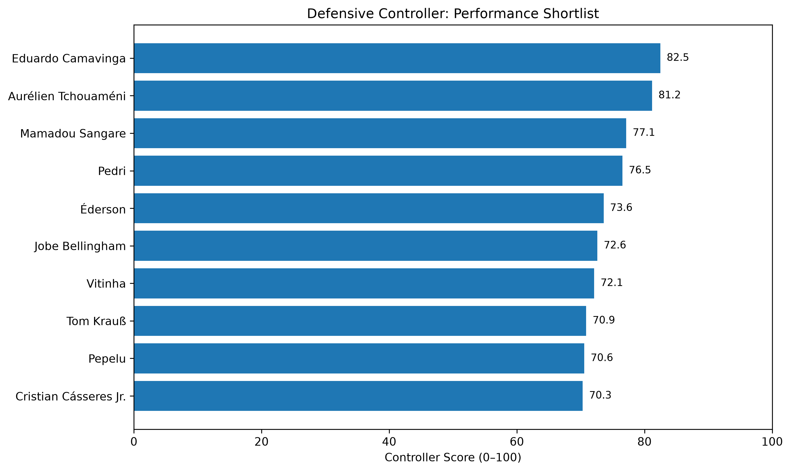
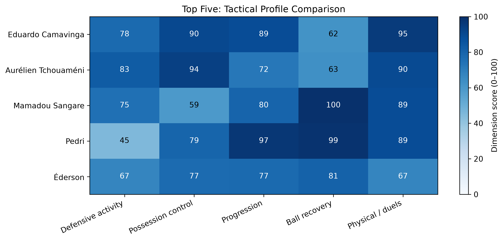
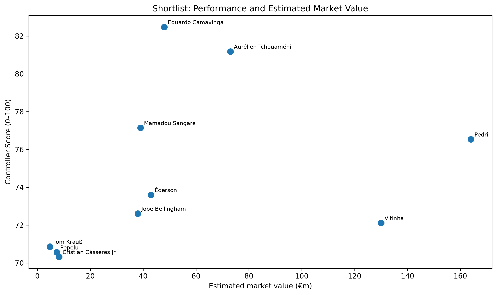

# Manchester United - Defensive Controller Recruitment Analysis

**A data-driven scouting case study using 2025/26 performance data from Europe's Big Five leagues.**

## Recruitment question

Which midfielders outside the Premier League could offer Manchester United a combination of defensive activity, possession control, progression, ball recovery and physical effectiveness, and which merit further scouting when estimated market value is considered?

This is an independent portfolio project, **not affiliated with Manchester United FC**. Its rankings are exploratory scouting aids, not claims about player availability or transfer negotiations.

## Executive summary

The analysis converts league-level player statistics into season-level profiles, standardises event counts per 90 minutes and scores players against an interpretable five-dimension **Defensive Controller** framework.

| Recruitment stage | Players |
|---|---:|
| Midfielders with detailed positional metadata | 349 |
| Eligible after ≥1,500 season minutes | 248 |
| Recruitment pool (age ≤28; no Premier League season involvement) | 95 |
| Top-decile performance shortlist | 10 |

**Highest Controller Scores:** Eduardo Camavinga (82.5), Aurélien Tchouaméni (81.2), Mamadou Sangare (77.1).

**Further scouting priorities:** Éderson (balanced profile), Tom Krauß (lower-valuation defensive specialist) and Mamadou Sangare (ball-recovery specialist). Camavinga and Tchouaméni serve as elite performance benchmarks rather than assumed attainable targets.

## Methodology

1. **Collect and inspect** 2025/26 SofaScore performance statistics for the Premier League, La Liga, Bundesliga, Serie A and Ligue 1, alongside available player metadata.
2. **Identify relevant midfielders** using detailed DM/MC positional information. Metadata coverage was incomplete due to source access restrictions; candidate coverage is therefore not exhaustive.
3. **Aggregate player-team records** into player-season records, preserving multi-club history. Recalculate percentages from aggregated numerators and denominators rather than averaging percentages.
4. **Filter and standardise:** retain players with at least 1,500 season minutes; express event counts per 90 minutes.
5. **Build a transparent role score** from within-sample percentile-based feature scores:

   | Dimension | Weight |
   |---|---:|
   | Defensive activity | 30% |
   | Possession control | 25% |
   | Progression | 20% |
   | Ball recovery | 15% |
   | Physical / duels | 10% |

6. **Review robustness** using alternative weighting scenarios and feature-correlation checks.
7. **Assess recruitment trade-offs** using estimated market values, a log-market-value regression and preliminary feasibility tiers. The value regression's R² is approximately 0.137; residuals are not evidence of actual transfer bargains.

For detailed implementation and checks, see [`02_data_preparation.ipynb`](notebooks/02_data_preparation.ipynb) and [`docs/methodology.md`](docs/methodology.md).

## Selected results

| Player | Controller Score | Estimated market value | Recruitment interpretation |
|---|---:|---:|---|
| Eduardo Camavinga | 82.5 | €48m | Elite all-round benchmark; very difficult feasibility tier |
| Aurélien Tchouaméni | 81.2 | €73m | Possession-oriented benchmark; very difficult tier |
| Mamadou Sangare | 77.1 | €39m | Strong ball-recovery profile; very difficult tier |
| Éderson | 73.6 | €43m | Balanced scouting option; difficult tier |
| Tom Krauß | 70.9 | €4.7m | Defensive, lower-valuation option; progression trade-off |

Values are dataset estimates, **not transfer fees**. Feasibility tiers are provisional and require external validation.

### Visualisations

## Recruitment Visualisations

### Defensive Controller Rankings



### Tactical Profile Comparison



### Performance vs Estimated Market Value




## Repository structure

```text
man-utd-recruitment-analysis/
├── assets/                         # Exported figures (to be added)
├── dashboard/                      # Reserved for optional future work
├── data/
│   ├── external/
│   ├── processed/
│   │   ├── defensive_controller_candidates_2025_26.csv
│   │   ├── recruitment_pool_2025_26.csv
│   │   └── defensive_controller_shortlist_2025_26.csv
│   └── raw/2025-26/
├── docs/
│   ├── assumptions.md
│   ├── design_decisions.md
│   ├── methodology.md
│   └── project_journal.md
├── notebooks/
│   ├── 01_data_collection.ipynb
│   ├── 02_data_preparation.ipynb
│   ├── 03_recruitment_analysis.ipynb
│   └── statsbomb.ipynb            # Exploratory notebook, not core workflow
├── reports/
├── src/
│   ├── collect_fbref.py
│   ├── collect_player_metadata.py
│   ├── test_browser.py
│   └── test_player_response.py
├── tests/
├── .gitignore
└── README.md
```

## Reproduce the analysis

1. Clone the repository and create a Python virtual environment.
2. Install dependencies used by the notebooks (including `pandas`, `numpy`, `matplotlib` and `scikit-learn`). A pinned dependency file should be added before release.
3. Open the notebooks in order: **01 → 02 → 03**. For the presentation notebook, the three processed CSV files under `data/processed/` are the direct inputs.
4. If raw data is unavailable or cannot be redistributed, use the processed data where licensing permits, or consult the methodology to understand the workflow. Data collection may be affected by third-party access limits.

Do not commit `.venv/`, `.venv-football-data/`, private credentials or restricted raw datasets.

## Limitations

- Player metadata retrieval was incomplete, so potentially relevant players may be missing.
- Per-90 metrics do not control for team possession, tactical instructions, opponent quality or league strength.
- Final-third passing and completed long balls are imperfect proxies for progression; off-ball intelligence is not directly captured.
- Dimension weights reflect a stated tactical hypothesis, not a model trained on successful transfers.
- Market values are estimates; acquisition costs, wages, contracts and player willingness are not verified.
- The score has not been externally validated against future performance or recruitment outcomes.

**Outcome:** A reproducible, interpretable recruitment-screening framework that narrows a large player pool into an evidence-led scouting shortlist while making its assumptions and trade-offs explicit.
